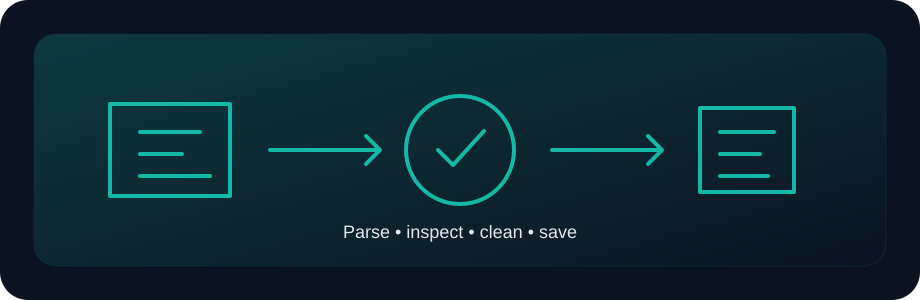

A local SVG sanitizer that removes active content, event handlers, and unsafe external references without uploading files.

   

## 🎯 Overview

SVG files can contain more than shapes and colors. SVG Cleanroom parses files locally and removes active elements, inline event handlers, and unsafe external references before writing a cleaned copy. It never uploads files and never modifies the original.

## ✨ Features

- 🧼 Removes script, foreignObject, iframe, object, and embed elements.
- 🛡️ Strips inline event handlers and non-local href/src references.
- 🔎 Offers a check-only mode for CI or pre-publish reviews.
- 📁 Keeps the original file untouched and writes a separate result.

## 🎬 Demo

<pre><code>python main.py examples/unsafe-demo.svg --output cleaned.svg
python main.py cleaned.svg --check</code></pre>

There is no hosted demo; run the command locally to see the real output.

## 🚀 Quick Start

<pre><code>python main.py examples/unsafe-demo.svg --output cleaned.svg</code></pre>

## 🧰 Tech Stack

- Python 3.10+ standard library
- xml.etree.ElementTree for local XML parsing

## 🗂️ Folder Structure

<pre><code>svg-cleanroom/
├── main.py
├── requirements.txt
├── examples/
│   └── unsafe-demo.svg
└── assets/
    └── illustration.svg</code></pre>

## 🧭 Roadmap

- [ ] Add an optional strict allow-list for SVG elements and attributes.
- [ ] Add a batch-directory mode with a JSON summary.
- [ ] Add focused unit tests for malformed and edge-case SVG files.

## 🤝 Contributing

Issues and pull requests are welcome. Keep changes focused, explain the behavior being changed, and include a reproducible example for bug reports.

## 📄 License

Released under the MIT License. See [LICENSE](LICENSE).

